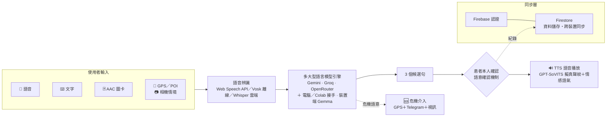

<div align="center">

# 🗣️ 拾語者 Speak My Life

**中風失語者的 AI 溝通與居家復健系統**

*Speak My Life — AI communication & home rehabilitation for stroke survivors with aphasia*

把散落的碎詞拾起，結合所在地點、相機看到的東西與大語言模型，重塑成自然、有溫度的句子——
由患者本人從三個候選句裡選一句，再用自己的聲音說出來。


[🌐 網頁版 Live](https://timchien918.github.io/Speak-My-Life-Web/) ·
[📦 下載安裝檔（Releases）](https://github.com/TimChien918/Speak-My-Life/releases) ·
[網頁版原始碼](https://github.com/TimChien918/Speak-My-Life-Web) ·
[GPT-SoVITS 模型手冊](docs/GPT_SOVITS_MODEL_GUIDE.md)

</div>

> **關於名稱**：本專案**已全面更名**為 **拾語者 Speak My Life**（繁中介面顯示「拾語者」，英／日／韓介面顯示「Speak My Life」），原名 **VoiceWeaver**。
> GitHub repo、Android 套件名／applicationId（`com.speakmylife.app`）、程式類別名（如 `SpeakMyLifeCore`）、Google Drive 雲端曲庫資料夾（`Speak-My-Life/…`）、
> 網頁版網址與桌面安裝檔檔名都已換成新名字；舊資料會自動搬過去，見〈[從 VoiceWeaver 升級](#從-voiceweaver-升級)〉。
> 唯一沒改的是 Firebase 專案 ID `voiceweaver-af4da`（Firebase 專案 ID 建立後無法更改，不影響使用）。

---

## 一句話定位

**讓失語症患者即使「無法說話」，也能「被世界聽見」。**
拾語者是一套「語意重建引擎」：不只練發音，而是把「想說卻說不出」的零碎詞語，結合情境感知與大語言模型重組成完整句子，
把與世界對話的主導權還給中風後的失語症、言語失用症與吶語症患者及其家庭。

## 設計動機

| 數據 | 說明 | 來源 |
| --- | --- | --- |
| **約 9,400 萬人** | 全球曾經歷中風的人數 | WSO、AHA |
| **約 1,200 萬人／年** | 全球每年新發生的中風個案 | WSO、AHA |
| **3～5 萬人／年** | 台灣每年新增的中風患者 | 衛生福利部 |
| **約三成** | 急性期中風患者伴隨失語症 | 系統性回顧 |
| **從發聲走向語意** | 語言復健的需求不只是「發得出音」，而是「說得出完整的意思」 | — |

## 三種症狀，三種困境

| 症狀 | 表現 | 拾語者怎麼幫 |
| --- | --- | --- |
| **失語症（Aphasia）** | 表達性：聽得懂卻說不出來，語句斷斷續續或只剩單字。接受性：聽覺理解受損，說出的內容混亂。綜合性：聽說讀寫皆受影響。 | 碎詞→完整句的語意重組、三個候選句由本人確認、AAC 符號卡、看圖說故事訓練 |
| **言語失用症（Apraxia of Speech）** | 大腦無法正確排序發音肌肉的動作，發音錯誤或講不出來。 | 點卡即說的 AAC、跟讀復健（錯誤字詞高亮、整段逐句練）、TTS 代為發聲 |
| **吶語症（Dysarthria）** | 控制發音的臉部與口腔肌肉麻痺無力，說話含糊不清。 | 專屬發音（錄下自己的發音當聲波模板，含糊也認得）、擬真聲紋合成、雲端 Whisper 對構音不標準語音的較高辨識率 |

## 系統架構



（純文字版）

```
使用者輸入（語音／文字／AAC＋GPS／相機情境）
        │
        ▼
語音 API（Web Speech／Vosk／Whisper） ──▶ 多 LLM 引擎（Gemini / Groq / OpenRouter …）
                                              │
                                              ▼
                              3 個候選句 ──▶ 患者確認 ──▶ TTS 語音播放（GPT-SoVITS 情感語音）
                                              │
──────────────────────────────────────────────┴──────────────────────────────
Firebase 認證 ＋ Firestore 同步層（身分驗證、資料儲存、手機／網頁／電腦跨裝置同步）
```

## 五大功能模組

### ① 語意織句引擎 ＋ 情境感知補位

- **解決的痛點**：患者腦中有完整的意思，說出口卻只剩「水……休息……現在」。旁人只能猜，猜錯了患者又無力更正。
- **操作方式**：在「**重組**」頁用語音／打字／點圖卡輸入碎詞；「你的情境」卡自動帶入 GPS 地點（離線 POI → Google Places → Overpass 逐層退回）與相機辨識到的物品。AI 一次產生 **3 個**符合當下情境的候選句（三次取樣、依共識排序），**由患者本人點選確認後才朗讀**——首創「語意確認機制」，語言的選擇權留在患者手上。不滿意可按「換一個／重新生成」。

### ② 多模態適應性無障礙介面

- **解決的痛點**：中風常伴隨肢體偏癱，手指點不準、甚至無法觸控；重度患者與長輩看不懂一般 App 介面。
- **操作方式**：設定裡選擇 **輕／中／重度**，介面自動切換字級、AAC 圖卡呈現與可見設定（見下方「三段防呆介面」）。**鼻控追蹤**（MediaPipe 鼻尖游標）、**停留點選（dwell）**、**眨眼掃描**、**高對比**（黑底黃字）、**超大字**（字體倍率 0.8–1.8）可個別開啟，並有觸控防呆（防手抖連點、捲動不誤觸、禁長按）。

### ③ AI 語音輔助 ＋ 復健軌跡追蹤

- **解決的痛點**：居家練習沒有治療師在旁，練得對不對不知道；治療師回診時也看不到兩次門診之間的練習狀況。
- **操作方式**：「**復健**」頁提供 **中／英／日／韓**、**四級題庫**（字詞〔名詞／動作〕→ 短句 → 情境句）；跟讀後 AI 即時回饋**流暢度、語調、錯誤內容**並高亮錯字，沒出聲不打分。「**報表**」頁把**反應時間與選句命中率**等行為數據轉成「**復健軌跡趨勢圖**」，可匯出 CSV／PDF 或定期以 Telegram 推送給家人與語言治療師參考。

### ④ 語意防護 ＋ 主動式危機介入

- **解決的痛點**：說不出話的人在情緒崩潰或危急時，最難向外求救；單純的關鍵字封鎖又可能把「替別人求救」的訊息擋掉。
- **操作方式**：系統主動偵測求救／自傷語意（關鍵字＋AI 判斷「是誰需要幫助」），本人求助時自動以 Telegram **發送 GPS 定位**與前後鏡頭快照給指定家人、**開啟免登入視訊**、畫面提供**呼吸引導**與當地專線直撥（台灣 **1925／119**，美國 988／911）。對話視窗只有家人回覆 `/end` 才會關閉（詳見下方「危機介入」）。

### ⑤ 擬真聲紋複製 ＋ 情感語音輸出

- **解決的痛點**：機器音說出的話不像「自己」，患者與家人都難以接受；同一種語氣說「我好開心」和「我好痛」也不對。
- **操作方式**：以 **GPT-SoVITS** 匯入患者病發前的錄音或家屬聲音建立角色（**需先勾選知情同意**），模型存在使用者自己的 Google Drive 曲庫；朗讀時依句子自動偵測**開心／難過／恐懼／驚訝／中立**，切換對應情緒的參考音（喜怒哀樂的情感語氣）。由電腦「語音中心」或 Colab GPU 運算，手機與網頁只送文字、收語音。

## 六張功能卡

| 功能卡 | 說明 | App 入口 |
| --- | --- | --- |
| 💬 **句子重組** | AI 將零散詞語重組為自然語句（3 個候選句，本人確認） | 「重組」頁 |
| 🎙 **語音復健** | AI 評分、錯誤標示與連續練習天數（streak）追蹤 | 「復健」頁 |
| 🃏 **AAC 符號卡** | 基於類別的符號溝通，依頻率／時段／地點排序，可拍照自訂 | 「AAC」頁 |
| 📈 **進度報告** | 趨勢圖、CSV／PDF 匯出、Telegram 推送 | 「報表」頁 |
| 🌏 **多語言 TTS／STT** | 中／英／日／韓介面、朗讀與跟讀辨識一鍵切換 | 設定 → 介面語言 |
| ☁️ **雲端同步** | Firebase 登入、Firestore 跨裝置同步（手機／網頁／電腦） | 設定 → Google 登入 |

## 六大傑出特性

1. **從發聲走向語意重建**：不只練習發音，更協助患者把零碎詞語組成完整句子。
2. **AI 協助，但由患者決定**：系統提供候選句與情境提示，最後仍由患者本人確認與選擇。
3. **介面隨能力調整**：依輕、中、重度需求，提供不同圖卡、操作與無障礙方式。
4. **跨裝置持續復健**：支援手機、網頁與電腦，讓居家與醫療端能延續使用與紀錄。
5. **復健歷程可追蹤**：將日常練習與表達紀錄轉為趨勢，作為後續復健參考。
6. **兼顧安全與隱私**：
   - **聲紋需經同意**——啟用 GPT-SoVITS／匯入錄音前必須勾選知情同意。
   - **錄音評分後刪除**——跟讀錄音評分完立即刪除，不留在裝置或伺服器上。
   - **危機訊息僅傳送給指定家人**——畫面、定位與聲音只送到使用者自行設定的家人 Telegram。

## 功能比較

| 功能項目 | Lingraphica | TD Snap | Constant Therapy | **拾語者** |
| --- | :---: | :---: | :---: | :---: |
| AI 碎詞語意重組 | △ | △ | ✕ | ✓ |
| GPS／影像情境補位 | ✕ | ✕ | ✕ | ✓ |
| 重症無障礙操作 | △ | ✓ | △ | ✓ |
| AI 語言復健回饋 | △ | △ | ✓ | ✓ |
| 長期復健追蹤 | △ | △ | ✓ | ✓ |
| 危機介入安全網 | — | — | — | ✓ |

✓ 完整支援　△ 部分支援　✕ 不支援　— 無此功能

---

## 四個入口，一套生態

| 入口 | 說明 | 取得方式 |
| --- | --- | --- |
| **📱 Android App** | 完整功能：離線推理、相機、定位、鼻控／眼動、語音復健（含雲端多語跟讀）、GPT-SoVITS 角色語音、雲端曲庫瀏覽與下載 | [Releases](https://github.com/TimChien918/Speak-My-Life/releases) 或自行建置 |
| **🌐 網頁輕量版** | 純瀏覽器免安裝；三段防呆介面（輕症／中症／重症全螢幕圖卡）；危機介入雙向通報與 App 對齊；可把語音／生圖／文字運算丟給電腦或 Colab 跑 | [直接開啟](https://timchien918.github.io/Speak-My-Life-Web/) |
| **🖥 語音中心（macOS / Windows）** | 桌面 App：GPT-SoVITS 語音合成、SD-Turbo 生圖、Qwen 文字推論、**雲端曲庫管理（Google Drive）** | [Releases](https://github.com/TimChien918/Speak-My-Life/releases) |
| **☁️ Colab GPU（免費算力）** | 免安裝的雲端運算：同一份 Google Drive 曲庫、免費 GPU 跑語音合成，手機／網頁走 ngrok 連線 | [notebook](tools/colab/Speak-My-Life_GPT_SoVITS_Colab.ipynb) |

- 手機、網頁、電腦用**同一個 Google 帳號**登入即互通：API 金鑰／設定雙向同步（Firestore），語音曲庫共用同一個 Drive。
- 四個入口的介面都支援**繁體中文／English／日本語／한국어**一鍵切換；切換語言會連動語音模型篩選、朗讀語言、以及跟讀練習用的語言。

## 功能總覽

| 分類 | 重點功能 |
| --- | --- |
| **語音重組** | 語音／文字輸入、碎詞整理、3 個候選句同時生成（自我一致性排序取共識最高的 3 句）、使用者先選一句再針對那句合成（不重複合成三份）、換一個／重新生成、TTS 朗讀＋音檔快取（同句不重複合成）、多語朗讀（中英日韓）、複製分享、我的最愛 |
| **AAC 圖卡** | 分類點選、整句緩衝（點卡進句、一次連貫朗讀）、依使用頻率／時段／地點與詞語共現的排序演算法（App）；費茲傑羅詞性色碼＋拍照自訂圖卡＋同一套排序演算法（網頁版） |
| **三段防呆介面** | 輕症（鍵盤為主，完整功能）／中症（超大圖卡預設展開，隱藏複雜設定）／重症（全螢幕逐張掃描圖卡，去科技化、無選單無返回鍵，網頁版另有照護者 PIN＋可見按鈕退出、螢幕常亮） |
| **語音復健** | AI 全判讀（語意／流暢／語氣，非字元差異）、**跟讀支援英／日／韓**（雲端 Whisper 多語轉寫，裝置端 Vosk 僅中文時自動退回）、**沒出聲不打分**（偵測靜音／噪音幻覺，不記錄假分數）、錯誤字／詞高亮、整段分句逐句練、AI 依程度推薦練習句、streak 連續天數、每日提醒 |
| **危機介入（雙向）** | 關鍵字攔截 → AI 判斷「想自傷的是誰」（本人／代替他人求助／無關，避免誤鎖住求救訊息）→ GPS＋Telegram 即時通報、前後鏡頭快照、免登入視訊通話房、**家人可下指令**（`/call` 強制視訊、`/camera` 再拍現場、`/end` 結束對話）、患者可傳語音訊息／安撫快捷語給家人、對話視窗需家人確認才能關閉、當地專線直撥（台灣 1925／119、美國 988／911） |
| **成績單** | Firestore 同步日誌、趨勢折線圖、正向情緒統計、行為數據（反應時間／選句命中率／修改次數／輸入方式比例）、CSV／PDF 匯出、Telegram 排程推送 |
| **定位情境** | GPS、住家錨點、離線 POI 索引（App 內建全球資料庫，含手動修正錯誤分類）→ Google Places → Overpass → Geocoder 逐層退回 |
| **相機辨識** | 前／後攝影機、AI 認物品（僅顯示有對應翻譯的物件，避免英文殘留）、加入情境 |
| **無障礙** | 鼻控游標（MediaPipe 鼻尖追蹤、靈敏度即時調整）、dwell 停留點選、眨眼掃描模式、觸控防呆（防手抖連點／捲動誤觸／禁長按）、超大字、高對比 |
| **看圖說故事** | 4 張情境圖卡組成故事、AI 講評鼓勵＋具體建議（分數用關鍵字命中率算，講評才交給 AI，避免同一段話重評分數跳動） |
| **角色語音（情緒感知）** | GPT-SoVITS 自訂聲音，依句子自動偵測情緒（開心／難過／恐懼／驚訝／中立）切換對應語氣的參考音；電腦／Colab 跑，手機／網頁連線 |
| **雲端曲庫** | Google Drive 是**唯一曲庫**，本機只是快取——手機／網頁／電腦都看同一份角色清單（依語言分區、已下載排前），未下載的角色一鍵抓到運算端，合成前自動確保就緒 |
| **多語介面** | 繁中／英／日／韓四語言，涵蓋所有畫面文字（含彈窗與非同步訊息）；LLM 輸出語言用該語言本身的祈使句要求，避免模型忽略夾在中文提示詞裡的英文指令 |

## 🧓 三段防呆介面

同一個 App／網頁，三種模式，照護者一鍵切換（依患者程度自動套用對應預設）：

- **🟩 輕症模式（語法訓練）**：鍵盤打字為主、完整功能。AAC 圖卡點選「只進整句緩衝」不即時朗讀，組完整句按「朗讀」一次連貫唸出（保留主動受語序訓練）。網頁版另有費茲傑羅詞性色碼當視覺錨點。
- **🟨 中症模式**：超大圖卡預設展開、隱藏複雜設定，介於輕重症之間的折衷。
- **🟥 重症／高齡防呆模式（建立信任）**：針對看不懂手機、對科技排斥的長輩——
  - **去科技化**：進入後自動全螢幕，整個畫面只剩幾張超大卡片，像一張實體塑膠墊板；無選單、無按鈕、無返回鍵。
  - **單一情境鎖定**：照護者鎖定「吃飯」「上廁所」等情境（或自己拍的照片卡），長輩怎麼按都不會跳到看不懂的畫面。
  - **點卡即回饋**：立即輕快朗讀（GPT-SoVITS 走「開心」情緒參考音；瀏覽器 TTS 則提高音調）＋提示音＋放大動畫，建立因果認知。
  - **防呆觸控**：所有觸發只認放開手指的那一刻、逐鍵防連點（手抖同點狂按只算一次）、捲動位移不觸發、全面禁止長按。
  - **照護者出口（網頁版）**：畫面上有一顆明確標示的「✕ 關閉」按鈕，點下去要輸入 4 位 PIN 才能離開——刻意設計成看得到的按鈕而不是隱形連點區，因為連照護者自己在真正緊急時都不見得能連點準；安全性完全靠 PIN，不靠「不好找」。螢幕常亮（Wake Lock）不熄滅。
  - **相機自訂圖卡（網頁版）**：直接拍長輩熟悉的物品／家人照片做成卡片——看到認得的東西最能建立信任。

## 🆘 危機介入：偵測、通報、雙向對話

App 與網頁版行為一致，三層防線：

1. **關鍵字攔截**：偵測到自傷／拒絕治療相關字眼即進入下一步判斷，容忍字元間夾雜空白（避免因辨識斷詞漏判）。
2. **AI 判斷意圖**（而非只看關鍵字）：分類成「本人想自傷」「代替他人求助（例如『我朋友想自殺，快叫救護車』）」「與自傷無關」「無法判斷」。刻意不掛「拒絕危險字眼」的防禦提示詞去做這個分類——那會讓模型直接拒答，而分類任務不該被擋。誤判本人為代他人求助，等於沒攔到真正的求救；誤判代他人求助為本人，等於堵住了另一個人唯一的求救管道，兩種誤判都要盡量避免。
3. **通報與介入**（本人求助時觸發）：
   - 立刻發 Telegram 通知家人（不等定位——定位最慢 6 秒，那 6 秒是家人還不知道出事的時間），定位補在第二則訊息。
   - 靜默擷取前／後鏡頭快照傳給家人，讓家人一眼看到現場狀況。
   - 給一個免登入免輸名字的視訊通話房連結（Jitsi），家人點了就能面對面。
   - **家人可在 Telegram 直接回覆指令**：`/call`（強制患者加入視訊）、`/camera`（要求再拍一次現場）、`/end`（結束對話）；其他文字直接顯示給患者看。
   - 患者可傳幾句安撫快捷語或自訂文字給家人，也能錄一段約 6 秒的語音訊息。
   - 呼吸引導動畫陪伴等待家人回應的過程。
   - 當地求助專線直撥（台灣 1925 安心專線／119，美國 988／911，按鈕上一定顯示號碼）、改撥家人電話備援。
   - **對話視窗使用者無法自行關閉**，只有家人在 Telegram 輸入 `/end` 才會關——會走到這個畫面的人，正是最不該讓他一個人把求救關掉的時候。
4. **輸出防線**：即使前面都被繞過，任何要唸出來的文字仍會經過關鍵字消毒，移除殘留的危險字句。

## 🗣️ 語音復健：支援中／英／日／韓跟讀

- **臨床題庫**：字詞（名詞／動作）、短句、情境句四級，取材自漢語標準失語症檢查表通用題，離線也能開始練。
- **跟讀辨識依語言能力自動路由**：
  - 有設定雲端語音轉寫金鑰（Whisper）→ 整題換成介面語言，顯示、朗讀、辨識、評分統一是同一種語言；Whisper 對構音不標準的語音也比裝置端的小模型準。
  - 沒有 → 維持中文題目（App 端裝置離線 STT 是中文專用模型，英文題目在這條路上永遠辨識不出來，改成中文題目＋非中文語意註解給照護者看）。
- **沒出聲就不打分**：偵測到錄音音量過低／過短，或辨識結果符合語音辨識引擎對靜音常見的固定幻覺句（例如字幕結尾的制式句子），一律視為「這次沒有資料」而不是「表現不好」——失語症患者「想說但發不出聲音」是最常見的嘗試之一，不該每次都記一筆假的低分。
- **AI 全判讀評分**：語意完整性、流暢性、語氣語調三面向綜合判斷，不是字元差異比對；每次評分刻意獨立、低溫求穩，同樣的表現要拿到一致的分數。
- **AI 推薦練習句**：依近期平均分、目前所在地點、已練過的句子動態出題，避免重複。
- 整段文章可自動分句逐句練，streak 連續練習天數激勵，每日提醒。

## ☁️ 雲端曲庫（Google Drive 是唯一事實來源）

聲音模型不再各裝置各存一份。架構是：

```
Google Drive（Speak-My-Life/<語言>/<角色>/）←── 唯一曲庫，登入哪個 Google 帳號就是哪份
        │                                       （更名前的 VoiceWeaver/ 會自動改名成 Speak-My-Life/）
        │  電腦／Colab 用 Drive API／掛載讀取
        ▼
運算端本機快取（沒有的角色會自動下載，下載完就是「已下載」）
        │
        │  /catalog（瀏覽整庫＋下載狀態）／/prepare（隨選下載）／/speak（合成）
        ▼
手機／網頁（不存模型、不合成，只送文字、收 WAV）
```

- **一次 Google 登入 ＝ Firebase 身分 ＋ Drive 存取權**：電腦端登入時會自動把兩者綁在一起（`drive.file` 範圍，只碰 App 自己建立的檔案，不觸及你 Drive 裡其他東西）。
- **匯入即上傳**：語音中心匯入單個／批量資料夾時，直接寫進曲庫的情緒結構並上傳到你自己的 Drive；不用手動搬檔案。
- **資料夾格式**：`<語言 ZH/EN/JA/KO>/<角色>/{*.ckpt, *.pth, reference_audios/**/emotions/【情緒】逐字稿.wav}`——檔名的【情緒】標籤決定該顆參考音對應哪種語氣。
- **`catalog.json`**：曲庫根目錄的目錄索引（角色／語言／情緒／大小），Mac 與 Colab 兩端寫出的格式完全一致，互為可信來源。
- **隨選下載＋續傳**：合成前運算端會自動確保角色已在本機；沒有就從 Drive 抓（支援中斷續傳，慢速網路也不必整包重來）。下載狀態是**實測**的（.ckpt＋.pth＋參考音都齊才算），已下載 🟢、未下載 ☁️，清單依語言分區、已下載排最前。
- **管理**：語音中心可「移除下載」（清本機快取、雲端保留）或「從雲端刪除角色」（丟 Drive 垃圾桶，可自行還原，會影響所有裝置看到的曲庫）。

## 快速開始（自行建置 Android App）

```bash
# 1. 取得原始碼
git clone https://github.com/TimChien918/Speak-My-Life.git
cd Speak-My-Life

# 2. 金鑰：複製範例並填入（.env 已被 gitignore，切勿提交）
cp .env.example .env
#    GEMINI_API_KEY / GROQ_API_KEY / OPENROUTER_API_KEY
#    COHERE_API_KEY / GOOGLE_PLACES_API_KEY / TELEGRAM_BOT_TOKEN

# 3. 雲端同步（選用）：到 Firebase Console 下載 google-services.json 放進 app/
#    （已被 gitignore，不入版控）

# 4. 建置（需要 JDK 17+；Android Studio 內建 JBR 最方便）
export JAVA_HOME="/Applications/Android Studio.app/Contents/jbr/Contents/Home"
./gradlew :app:assembleDebug      # 打包 Debug APK
./gradlew :app:installDebug       # 安裝到已連線裝置
# 產物：app/build/outputs/apk/debug/app-debug.apk（套件名 com.speakmylife.app）
adb install -r app/build/outputs/apk/debug/app-debug.apk
adb shell am start -n com.speakmylife.app/.MainActivity
```

> **需要 JDK 17+**。系統 JDK 8 會出現 `Gradle requires JVM 17 or later`，請改用 Android Studio 內建 JBR。
>
> **APK 用 debug 簽章發布**：本專案的 release 版本沿用同一把 debug key（非正式上架用金鑰），這樣才能對已安裝的使用者 `adb install -r` 直接覆蓋更新、保留資料，不必解除安裝。**更名後 applicationId 改成 `com.speakmylife.app`，對系統來說是一個全新的 App**：舊的 VoiceWeaver App 不會被覆蓋，兩者會並存（見〈從 VoiceWeaver 升級〉）。

## 從 VoiceWeaver 升級

本專案原名 VoiceWeaver，已全面更名為「拾語者 Speak My Life」。舊使用者要做的事：

**需要你自己動手的**
1. **GitHub repo 改名**（開發者）：到 GitHub 各 repo 的 Settings → General → Repository name，把
   `TimChien918/VoiceWeaver` 改成 `Speak-My-Life`、`TimChien918/VoiceWeaver-Web` 改成 `Speak-My-Life-Web`
   （GitHub 會自動把舊網址轉址；本機 clone 可用 `git remote set-url origin https://github.com/TimChien918/Speak-My-Life.git` 更新）。
   網頁版改名後網址變成 https://timchien918.github.io/Speak-My-Life-Web/ （GitHub Pages 不會替舊網址轉址）。
2. **Firebase 新增 Android App**（自行建置者）：Firebase Console → 專案設定 → 新增應用程式 → Android，
   套件名填 `com.speakmylife.app`（並加上簽章 SHA-1，Google 登入需要），下載新的 `google-services.json` 換掉 `app/` 裡舊的。
3. **新舊 App 並存，需手動移除舊版**：applicationId 從 `com.aistudio.aphasiaassist.pkztuv` 改成 `com.speakmylife.app`，
   系統把它當成另一個 App，安裝新版不會覆蓋舊版。確認新版設定都回來後，到手機設定把舊的 VoiceWeaver App 解除安裝。
4. **用同一個 Google 帳號登入新 App**：新 App 讀不到舊 App 的本機資料（Android 的資料夾以套件名區隔），
   但設定、紀錄都存在 Firebase 雲端——登入同一個 Google 帳號就會同步回來。

**會自動處理的**
- **Google Drive 曲庫**：Android、網頁、電腦、Colab 四端同一條規則——先找 `Speak-My-Life/`；沒有但有舊的 `VoiceWeaver/`
  就把它改名成 `Speak-My-Life/`（不重新上傳，只改名）；改名失敗（例如資料夾不是 App 建立的）就繼續使用舊資料夾；兩個都有則用新的、不動舊的。
- **電腦端資料夾**：`~/VoiceWeaver-電腦端/` → `~/Speak-My-Life-電腦端/`，App 資料夾
  `~/Library/Application Support/VoiceWeaver`（Windows `%LOCALAPPDATA%\VoiceWeaver`）→ `…/Speak-My-Life`，
  `~/.voiceweaver` → `~/.speakmylife`，語音設定檔 `voiceweaver_tts_infer.yaml` → `speakmylife_tts_infer.yaml`。
  資料夾在舊位置留捷徑，裡面寫死的舊路徑照樣能用，不必重裝；改名失敗就沿用舊路徑。
- **手機同步資料夾**：USB 同步時把 `/sdcard/VoiceWeaver/voice_models` 搬到 `/sdcard/Speak-My-Life/voice_models`。
- **Colab**：notebook 掛載 Drive 時同樣把 `MyDrive/VoiceWeaver` 改名；Colab Secret 請改名為 `SML_PAIR_CODE`（舊的 `VW_PAIR_CODE` 仍讀得到）。
- **語音中心**：舊的 `VoiceWeaver語音中心.app`／`.exe` 不會被自動刪除，裝好新版後可自行移除。

**無法改名、但不影響使用的**
- Firebase 專案 ID `voiceweaver-af4da`：Firebase 專案 ID 建立後永遠不能改（顯示名稱可在 Console 改）。
  它只出現在設定檔與網址裡，使用者看不到，也不影響任何功能。

## 🖥 語音中心（macOS / Windows 桌面 App）

自帶 Python 環境的桌面應用（Tkinter），下載 `.dmg`／`.exe` 安裝即用，首次開啟自動解壓環境（約 2GB）。
視窗標題顯示「拾語者 語音中心」；App 檔名為 `Speak-My-Life語音中心.app`／`Speak-My-Life語音中心.exe`（安裝檔 `Speak-My-Life-語音中心.dmg`）。
一個視窗管理三個 AI 服務＋手機連線＋雲端曲庫：

| 埠 | 服務 | 說明 |
| --- | --- | --- |
| `9880` | 語音合成（GPT-SoVITS） | 首次啟動可一鍵下載基礎模型（約 1.6GB）；角色模型來自雲端曲庫 |
| `9881` | 本機生圖（SD-Turbo） | 首次生圖自動下載模型（免金鑰） |
| `9882` | 文字推論（Qwen2.5-1.5B） | 句子重組／復健評分的「電腦接手」來源 |
| `9879` | 橋接（含 CORS） | 手機語言同步 ＋ 網頁版的語音／生圖／文字／曲庫代理（`/catalog`、`/prepare`、`/speak`…） |

**雲端曲庫管理**：Google 登入（一次綁定 Firebase＋Drive）、2 欄宮格清單（顯示每個角色的下載狀態／大小／情緒）、下載⇄移除下載一鍵切換、單個與批量資料夾匯入（自動上傳到 Drive）、從雲端刪除角色、語言篩選（中／英／日／韓，跟手機介面語言自動連動）。

**手機連線三選一**：
| 方式 | 設定 |
| --- | --- |
| 有線 USB（推薦） | 插線即可，自動 `adb reverse`；首次同步後自動開啟無線並記住 IP |
| 無線 Wi-Fi | App 填 `http://<電腦IP>:9880`，或掃語音中心的 QR Code 自動填入 |
| Tailscale（外網） | 填 `100.x` 位址；4G／5G 也能連 |

> 打包腳本：`tools/dmg/build_dmg.sh`（macOS）、`tools/win/build_win.ps1`（Windows）。安全網會強制剔除任何模型權重，**安裝檔絕不內含聲音模型**——模型只透過使用者自己的 Google Drive 流動。

## ☁️ Colab GPU（免費雲端算力）

不想讓自己的電腦跑推論、或電腦效能不夠時，用 [Google Colab](https://colab.research.google.com) 的免費 GPU：

1. 上傳 [`tools/colab/Speak-My-Life_GPT_SoVITS_Colab.ipynb`](tools/colab/Speak-My-Life_GPT_SoVITS_Colab.ipynb) 到 Colab，選 GPU（T4）執行階段。
2. 依序執行每個 cell：安裝相依 → 掛載 Drive（同一個帳號的曲庫，會自動建 ZH/EN/JA/KO 範本並印逐角色健檢報告）→ 啟動服務 → 開 ngrok 通道。
3. 手機或網頁的「連接電腦」設定頁填入 ngrok 給的公開網址，或直接按「☁️ 用此 Colab 網址連線」。
4. Colab 端的橋接（`speakmylife_bridge.py`）與語音中心走同一套情緒偵測、同一份 `catalog.json` 格式，行為完全一致。

> ngrok 授權碼透過配對碼從你的帳號雲端取用，不需要把授權碼貼進 notebook。

### Colab 連線疑難排解

| 症狀 | 原因與處理 |
| --- | --- |
| `ERR_NGROK_9038`（Invalid URL / trailing '/'） | 固定網域欄位貼了整串網址——**已自動清洗**（notebook 與網頁都會把 `https://…/` 轉成純網域），更新 notebook 後重跑即可 |
| 網頁偵測不到 Colab、但手機連得上 | ngrok 免費版對瀏覽器插「警告攔截頁」——網頁**已自動帶** `ngrok-skip-browser-warning` 繞過；若還是不行，確認跑的是最新 notebook（舊版橋接未放行該標頭） |
| 連上了但顯示「雲端上沒有任何語音模型」 | 舊版 notebook 沒把 `MODELS_ROOT` 傳給橋接、看不到 Drive 曲庫——用最新 notebook 重跑 |
| 下載成功卻一直顯示「未下載」 | 舊版橋接不回報下載狀態；新版網頁會直接提示「伺服器版本較舊，請用最新 notebook 重啟」 |

## 🌐 網頁版（免安裝）

- 開頁一顆大按鈕「**▶ 直接開始**」（免帳號、資料存本機）；照護者可用 Google 登入做跨裝置同步。會記住上次使用的分頁。
- 純瀏覽器＋自備 API 金鑰即可用：重組、AAC（含三段防呆模式）、復健評分、成績單、生圖、看圖說故事。
- **危機介入與 App 對齊**：前後鏡頭快照、家人 `/call` `/camera` `/end` 指令、語音訊息、家人才能關閉的對話視窗，見上方「危機介入」章節。
- **讓電腦／Colab 幫忙跑運算**：設定頁啟用後，語音（GPT-SoVITS 角色聲音，情緒感知）、生圖（SD-Turbo）、文字（Qwen）都交給你的電腦或 Colab，連不上自動退回雲端／瀏覽器。
  - 同一台電腦：免設定，直接「偵測連線」（走 `127.0.0.1:9879`）。
  - Colab：填 ngrok 固定網域後按「☁️ 用此 Colab 網址連線」一鍵套用。
  - 遠端電腦：跑 `tailscale serve --bg 9879`，網頁填 `https://主機.xxx.ts.net`。
  - ⚠️ 受瀏覽器混合內容限制，HTTPS 網頁無法連區網 `http://192.168.x.x`——僅同機、Colab（ngrok）、Tailscale 三種連法。
- **雲端曲庫瀏覽**：整個 Drive 曲庫依語言分區（每區含 N/M 已下載統計），已下載 🟢 排最前，未下載 ☁️ 一鍵請運算端下載（含進度與續傳）。
- **語音辨識跟著介面語言走**：切到英文介面，麥克風輸入與復健跟讀辨識都直接認英文，不必額外設定。

## 技術架構

- **Android**：Kotlin + Jetpack Compose；Room（歷史／復健／故事訓練日誌）＋ DataStore（設定）；WorkManager（提醒／推送）；CameraX + ML Kit；Vosk（離線 STT，中文專用，逐字信心度）＋ 雲端 Whisper（多語轉寫，跟讀專用）
- **網頁**：純 Vanilla JS + ES Modules（無框架、無建置步驟，GitHub Pages 直接部署）；`interaction.js` 統一觸控防呆；`kiosk.js` 防呆模式；`predict.js` 詞性預測；`aacrank.js` 使用頻率排序；`zhconv.js` 簡轉繁（OpenCC，字元＋詞組雙層對照，round-trip 校驗避免破壞正確繁體字）
- **雲端同步**：Firebase Auth（Google／匿名）＋ Firestore（金鑰、設定、復健日誌，與網頁版共用結構）；電腦端額外用 Google OAuth（`drive.file`）存取使用者自己的 Drive 曲庫，同一次登入會把 Firebase 身分與 Drive 授權綁在一起
- **多語系**：strings.xml 四語資源 ＋ `I18n.tr()` 執行期翻譯層（覆蓋 lambda／ViewModel 內的動態訊息，含 Compose Dialog 內容需重新套用語言設定的修正）；網頁 `data-i18n` 屬性驅動；語音中心 `I18N` 字典＋標題列語言切換（記住選擇）；LLM 輸出語言要求直接用該語言本身書寫，避免夾在中文提示詞裡的指令被忽略
- **推理分層**（依裝置能力與網路自動路由）：

  | 層級 | 引擎 | 說明 |
  | --- | --- | --- |
  | 電腦／Colab 接手 | `OffloadManager` → 9880/9881/9882（橋接 9879） | USB／區網／Tailscale／ngrok，實測 RTT 分級 |
  | 雲端 | `CloudInferenceEngine` | Gemini / Groq / OpenRouter / Cohere…，多金鑰依實測成功率／延遲自動排序 |
  | 裝置端 | `MediaPipeLLMEngine` | Gemma 3n E2B / Qwen（MediaPipe .task） |
  | 備援 | `RegexTemplateEngine` | 規則模板，零依賴 |

- **句子重組（自我一致性排序）**：同時發出 3 次雲端取樣，每次各回傳最多 3 個候選句，攤平後依「相同文意的次數、再看平均信心」排序，取前 3 讓使用者挑；挑中哪句才針對那句合成語音，不會三句都合成。
- **復健評分（四層備援、刻意求穩）**：電腦 Qwen → 雲端 LLM → 裝置端 Gemma → 字元相似度／詞語重疊。
  每次評估**完全獨立**（提示詞明確禁止參考先前分數）、低溫取樣、供應商固定順序不輪替——同樣的表現拿到一致的分數。
- **語音合成**：多供應商依實測成功率／延遲/免費與否自動排序、失敗自動換下一家；同一句話＋同一個聲音的合成結果會快取（LRU，上限 80 個檔案），重複朗讀不必重新合成；全部雲端管道失敗才退回手機內建語音。

## 設定項目（Android）

| 設定 | 預設 | 說明 |
| --- | --- | --- |
| `language` | English | 介面＋朗讀＋跟讀辨識語言（繁中／EN／日／韓），連動聲音模型篩選。四個入口的預設都是英文 |
| `theme` / `highContrast` | 科技風 / off | 視覺風格、高對比（黑底黃文） |
| `severityMode` | 輕度 | 輕度／中度／重度，決定字級預設、AAC 圖卡呈現方式、是否隱藏複雜設定 |
| `fontScale` | 1.0 | 全域字體倍率（0.8–1.8） |
| `noseSensitivity` | 1.0 | 鼻控靈敏度（0.5–2.0，即時生效） |
| `powerMode` | 標準 | 省電／標準（依硬體自動分流）／高效能 |
| `dailyReminderEnabled` / `Hour` | off / 9 | 每日復健提醒 |
| `reportPushFrequency` | none | 成績單 Telegram 推送（none／daily／weekly） |
| `gptSovitApiBaseUrl` | — | 電腦／Colab 位址（可存多台，連不上自動換下一個） |
| `emergencyChatId` | 空白 | Telegram 緊急通報接收者（不內建預設值） |
| `emergencyPhoneNumber` | 空白 | 危機介入視窗的備援直撥電話 |
| `customAacItems` | 空 | 自訂 AAC 圖卡（文字＋表情符號，JSON） |

## 權限（Android）

| 權限 | 用途 |
| --- | --- |
| 麥克風 | 語音輸入、跟讀錄音（含雲端多語轉寫） |
| 定位 | GPS 情境、住家錨點、緊急通報 |
| 相機 | 前／後鏡頭辨識、鼻控追蹤、危機介入現場快照 |
| 網路 | 雲端 AI、電腦／Colab 連線、Telegram |
| 通知 | 每日提醒、成績單推送 |
| 儲存／媒體 | 參考音檔匯入、CSV／PDF 匯出 |

## 專案結構

```text
app/src/main/java/com/speakmylife/app/
├── ui/
│   ├── SpeakMyLifeScreen.kt      語音重組（3 候選句挑選、多語朗讀、最愛、複製分享）
│   ├── AacScreen.kt              AAC 圖卡（大圖卡模式、自訂圖卡、使用頻率排序）
│   ├── RehabScreen.kt            語音復健（雲端多語跟讀、AI 評分、錯誤高亮、整段練習）
│   ├── training/StoryTrainingScreen.kt  看圖說故事訓練
│   ├── report/ReportScreen.kt    成績單（趨勢圖、行為數據、CSV/PDF 匯出）
│   ├── CrisisConversationWindow  危機介入（視訊、語音訊息、家人指令、現場快照）
│   ├── SettingsScreen.kt         設定＋雲端曲庫瀏覽（CloudLibraryPanel）＋ngrok/Colab
│   ├── I18n.kt                   執行期翻譯層（動態訊息四語、LLM 輸出語言指令）
│   ├── LocaleProvider.kt         Compose 語言切換（含 Dialog 內容重新套用語言的修正）
│   └── settings/ + theme/        進階設定、AppPalette
├── ai/
│   ├── SpeakMyLifeCore.kt        核心 ViewModel、危機通報流程、復健錄音路由
│   ├── CloudInferenceEngine.kt   雲端推理（電腦接手 → 雲端 → fallback）、自我一致性排序、Whisper 純轉寫
│   ├── MediaPipeLLMEngine.kt     裝置端 Gemma/Qwen
│   ├── OffloadManager.kt         電腦接手（連線分級、/reconstruct 代理）
│   ├── LocalSovitsHelper.kt      GPT-SoVITS 連線、情緒偵測、雲端曲庫瀏覽/下載
│   ├── SpeechToTextManager.kt    Vosk 離線 STT（中文專用，簡轉繁）
│   ├── SpeechNoiseGuard.kt       跟讀錄音的靜音／幻覺防護
│   ├── AacUsageRanker.kt         AAC 圖卡使用頻率／時段／地點排序
│   ├── AacContextSuggester.kt    依地點情境的快捷句與拍照物件建議
│   ├── OfflinePoiIndex.kt        離線 POI 索引（含分類手動修正）
│   ├── VisionLabelZh.kt          相機辨識結果的白名單翻譯
│   └── CrisisMediaCapturer.kt    危機介入用的前後鏡頭快照＋語音錄製
├── safety/
│   ├── SafetyGuard.kt            關鍵字攔截、風險分級、輸出消毒
│   └── EmergencyTrigger.kt       GPS＋Telegram 通報門面
├── work/                          WorkManager（提醒、推送、匯出）
└── MainActivity.kt

app/src/main/assets/
├── nose_tracker.html   鼻控 WebView（MediaPipe Face Mesh，四語狀態訊息）
└── poi/                離線 POI（台灣／美國）

tools/
├── GPT-SoVITS/
│   ├── voice_center_app.py     語音中心 GUI（Mac/Win 共用，四語介面；雲端曲庫管理）
│   ├── drive_uploader.py       Google Drive 曲庫（OAuth 登入合一、上傳/下載/刪除、續傳）
│   ├── emotion_models.py       情緒資料夾掃描＋偵測＋catalog（api_v2／語音中心／Colab 共用邏輯）
│   ├── api_v2.py               GPT-SoVITS 推論 API（9880）＋ /catalog /prepare
│   ├── model_setup_server.py   模型管理後端（掃描、匯入）
│   ├── text_infer_server.py    Qwen 文字推論（9882）
│   ├── image_gen_server.py     SD-Turbo 生圖（9881）
│   ├── sync_voice_models.py    USB 手機↔電腦模型同步（次要路徑，雲端曲庫為主）
│   └── sml_migrate.py          更名搬遷（舊 VoiceWeaver 資料夾／Drive 曲庫自動改名；附 test_sml_migrate.py）
├── colab/
│   ├── Speak-My-Life_GPT_SoVITS_Colab.ipynb 雲端算力 notebook（掛 Drive、健檢、起服務、開 ngrok）
│   └── speakmylife_bridge.py                Colab 端橋接（與語音中心同一套情緒/曲庫邏輯，內嵌於 notebook）
├── dmg/build_dmg.sh    macOS .dmg 打包（權重安全網）
└── win/build_win.ps1   Windows 打包
```

## 隱私與授權

- **不內建任何語音模型／角色音色**：聲音由使用者自行匯入有權使用的素材；安裝檔打包時安全網強制剔除權重。
- **曲庫存在使用者自己的 Google Drive**：電腦端用 OAuth `drive.file` 範圍存取——App 只能看到／管理它自己建立的檔案，碰不到你 Drive 裡其他東西；不會有任何檔案經過開發者。
- **金鑰不入版控**：`.env`、`app/google-services.json`、`google_client_secret.json` 皆已 `.gitignore`；API 金鑰只存在使用者裝置與其個人 Firestore。
- **聲紋屬生物特徵**：啟用 GPT-SoVITS／匯入錄音前需勾選知情同意（聲音主體同意、僅個人非商業溝通用途、不得冒充他人）。
- **危機通報**：畫面與聲音僅傳給使用者自行設定的家人 Telegram，不經任何第三方伺服器。
- **跟讀錄音**：語音檔案評分完立即刪除，不留在裝置或伺服器上。
- **第三方授權**：[GPT-SoVITS](https://github.com/RVC-Boss/GPT-SoVITS) 為 **AGPL-3.0**，`.dmg`／`.exe` 散布時隨附其 `LICENSE`。
- 本專案程式碼本身尚未公開授權（保留所有權利）；如需重用請先聯絡作者。

## 參考資料

1. 世界中風組織（WSO）。〈願景與策略：全球中風現況〉。
2. 衛生福利部（2026）。〈長照3.0新亮點：復健病房啟航〉。
3. Brady, M. C., et al.（2016）。〈中風後失語症的語言治療〉（Speech and language therapy for aphasia following stroke）。*Cochrane Database of Systematic Reviews*。
4. 美國聽語學會（ASHA）。〈輔助與替代溝通（AAC）臨床實務指引〉。
5. 台灣聽力語言學會。〈中風後失語症的語言復健－穿顱磁刺激與限制性誘導治療〉。
